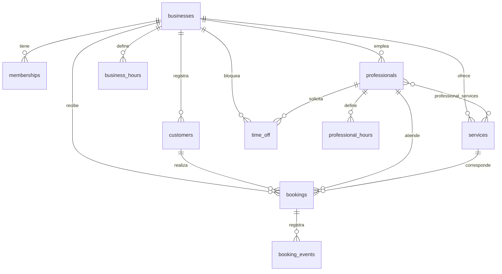

# CONTEXT.md

> Documento vivo de arquitectura y decisiones estructurales. Actualízalo cuando cambien el stack, los módulos, las integraciones o las decisiones de arquitectura; no por cada ajuste pequeño.

## Propósito

Reserva2 es una plataforma SaaS que permite a pequeños negocios y profesionales independientes publicar sus servicios y recibir reservas en línea, y a sus clientes reservar sin llamar ni crear una cuenta. El producto concentra agenda, catálogo, equipo y clientes en un único panel.

## Alcance y usuarios

- **Usuarios principales:** propietarios y personal de barberías, salones, consultorios, entrenadores, estudios de tatuaje y profesionales independientes.
- **Usuarios secundarios:** clientes finales que reservan desde el móvil sin registrarse.
- **Problema / necesidad:** agendas dispersas en papel, WhatsApp y hojas de cálculo; disponibilidad desactualizada; doble reserva; falta de historial de clientes.
- **Funcionalidades incluidas:** reserva pública, panel administrativo, calendario, servicios, profesionales, clientes, configuración, dashboard.
- **Fuera de alcance:** pagos, suscripciones, notificaciones automáticas, IA conversacional, analítica avanzada, app nativa, multiidioma.

## Stack

| Capa | Tecnología | Versión objetivo |
|---|---|---|
| Framework | React | 19 |
| Build | Vite | 8 |
| Lenguaje | TypeScript (estricto) | 6.0 |
| Estilos | Tailwind CSS v4 (`@theme`) | 4.3 |
| Componentes | shadcn/ui (código propio) sobre Radix | — |
| Routing | React Router | 7 |
| Formularios | React Hook Form + Zod (+ `@hookform/resolvers`) | 7 / 4 |
| Estado de servidor | TanStack Query | 5 |
| Estado de UI | URL (`searchParams`) + estado local | — |
| Animación | Motion (`motion/react`) | 14 |
| Fechas | date-fns + `@date-fns/tz` | 4 / 1.5 |
| Gráficos | Recharts | 3 |
| Iconos | lucide-react | 1 |
| Notificaciones UI | Sonner | 2 |
| Tipografías | `@fontsource-variable/fraunces`, `@fontsource-variable/instrument-sans` | 5.3 |
| Backend / BD | Supabase (PostgreSQL + Auth + Storage) | CLI 3 |
| Cliente de datos | `@supabase/supabase-js` | 2 |
| Testing | Vitest + React Testing Library + Playwright | 5 / 16 / 1.65 |
| Hosting | Vercel (frontend) + Supabase Cloud (datos) | — |
| Analítica | No implementada | — |

## Arquitectura

```
Navegador
  └─ React (Vite)
       ├─ features/*            → pantallas y flujos
       ├─ components/ui/*       → primitivas accesibles (shadcn re-tematizado)
       ├─ lib/*                 → cliente Supabase, Query, formato, fechas
       └─ @supabase/supabase-js
              │  (anon key, RLS activo)
              ▼
       Supabase
       ├─ Auth            → usuarios del panel
       ├─ PostgreSQL
       │    ├─ RLS        → aislamiento por business_id
       │    ├─ RPC        → get_available_slots, create_booking, get_booking_status…
       │    └─ EXCLUDE    → imposibilita solapamientos por profesional
       └─ Storage         → logos
```

**Regla de oro:** el frontend es UX; la seguridad y las reglas de negocio viven en PostgreSQL. Ninguna validación crítica se confía al navegador.

### Modelo de datos



Entidades principales:

- `businesses` — tenant. `slug` único, `timezone` IANA, `currency`, política de reservas y `is_published`.
- `memberships` — vínculo `auth.users` ↔ `businesses` con rol (`owner`, `admin`, `staff`). Es la base de todas las políticas RLS.
- `services` — duración, precio en céntimos y buffer posterior.
- `professionals` — equipo; `professional_services` define qué servicios puede realizar cada uno.
- `business_hours` / `professional_hours` — horario semanal. Si un profesional no tiene fila para un día, hereda el horario del negocio.
- `time_off` — ausencias por rango; `professional_id` nulo bloquea todo el negocio.
- `customers` — único por `(business_id, lower(email))`.
- `bookings` — `starts_at`/`ends_at`/`blocked_until`, estado, snapshots de precio y duración, `confirmation_token` (UUID público).
- `booking_events` — historial de cambios de estado.

### Flujo de migraciones

1. Se escribe un archivo SQL nuevo en `supabase/migrations/` (numerado, pequeño y reversible cuando sea posible).
2. Se revisa con `supabase db diff` y `supabase db lint`.
3. Se aplica con `pnpm db:push` al proyecto de desarrollo.
4. Se regeneran los tipos con `pnpm types:gen`.
5. El mismo PR incluye migración, tipos y código que los usa.

No se edita una migración ya aplicada: se añade otra que la corrija.

## Estructura de carpetas

```text
Reserva2/
├─ frontend/
│  ├─ src/
│  │  ├─ app/            # router, providers, layouts
│  │  ├─ features/       # auth · public-booking · dashboard · bookings · calendar
│  │  │                  # services · staff · customers · settings
│  │  ├─ components/
│  │  │  ├─ ui/          # shadcn re-tematizado (solo reutilizables)
│  │  │  ├─ business/    # piezas del dominio
│  │  │  └─ shared/
│  │  ├─ lib/            # supabase, query client, formato, fechas, utils
│  │  ├─ pages/          # vistas de ruta
│  │  ├─ styles/         # index.css con tokens @theme
│  │  └─ types/          # tipos generados de la BD
│  └─ tests/             # unitarios e integración
├─ supabase/
│  ├─ migrations/        # esquema, RLS, RPC
│  ├─ seed.sql           # datos de demostración (nunca producción)
│  └─ config.toml
├─ docs/                 # PRD · TRD · FLOW · UX · IMPLEMENTATION_PLAN · DECISIONS
├─ .github/workflows/    # CI
└─ (documentos operativos en la raíz)
```

Regla: un componente entra en `components/ui/` solo si se usa en dos o más lugares. Si no, vive junto a su feature.

## Integraciones y variables de entorno

| Variable | Uso | Expuesta al cliente | Obligatoria |
|---|---|---:|---:|
| `VITE_SUPABASE_URL` | URL del proyecto Supabase | Sí (pública por diseño) | Sí |
| `VITE_SUPABASE_ANON_KEY` | Clave anónima; RLS impide accesos indebidos | Sí (pública por diseño) | Sí |
| `VITE_APP_URL` | URL absoluta de la app para enlaces y metadatos | Sí | No |
| `SUPABASE_ACCESS_TOKEN` | CLI: login, `db push`, `gen types` | No — solo scripts locales | Sí (CLI) |
| `SUPABASE_PROJECT_ID` | Identificador del proyecto | No | Sí (CLI) |
| `SUPABASE_DB_PASSWORD` | Operaciones de base de datos | No | No |
| `SUPABASE_DB_URL` | Conexión directa opcional (`psql`) | No | No |

Documenta nombres y propósito, nunca valores. Mantén `.env.example` (raíz y `frontend/`) actualizados.

> La `service_role key` **no** se usa en el frontend ni se documenta como variable de la app. Si un script la necesita, se pasa por entorno y nunca se versiona.

## Decisiones técnicas

| Decisión | Motivo | Fecha / contexto |
|---|---|---|
| Supabase como backend completo (Postgres + RLS + RPC), sin servidor Node propio | Menos superficie que mantener; la autorización se valida donde viven los datos | Fase 1 |
| Disponibilidad calculada en una función SQL única | Cliente y creación de reserva usan la misma fuente de verdad; imposible que se contradigan | Fase 1 |
| `EXCLUDE USING gist` sobre `bookings` | Impide solapamientos incluso con peticiones concurrentes, sin depender de lógica de aplicación | Fase 1 |
| `timestamptz` + `timezone` IANA por negocio | Un negocio en Lima y un cliente en Madrid deben ver la misma hora correcta | Fase 1 |
| Precios en enteros (céntimos) y moneda por negocio | Evita errores de coma flotante y permite múltiples monedas | Fase 1 |
| Sin Zustand: TanStack Query + estado en URL | Menos estado duplicado; el asistente de reserva queda navegable y compartible | Fase 1 |
| shadcn/ui re-tematizado en lugar de una librería cerrada | Da primitivas accesibles sin imponer la estética genérica de dashboard | Fase 1 |
| Calendario propio en lugar de FullCalendar/React Big Calendar | Control visual total y menos peso; el aspecto genérico se descartó por decisión de producto | Fase 1 |
| Fuentes autoalojadas con `@fontsource-variable` | Sin peticiones a Google Fonts; privacidad y rendimiento | Fase 1 |
| Identidad «Editorial cálida» | Se aleja del azul SaaS genérico y encaja con barberías, salones y consultorios | Fase 1 |

## Requisitos no funcionales

- **Responsive:** móvil, tablet y escritorio; el flujo público es mobile-first.
- **Accesibilidad:** objetivo WCAG 2.2 AA cuando sea viable; foco visible, landmarks, `aria-live`, respeto a `prefers-reduced-motion`.
- **Rendimiento:** rutas del panel con carga diferida, imágenes optimizadas y evitar JS innecesario.
- **Seguridad:** RLS en todas las tablas, RPC con permisos explícitos, `search_path` fijado, secretos fuera del cliente y mínimo privilegio.
- **SEO:** metadatos por ruta en landing y páginas públicas; `noindex` en el panel.
- **Observabilidad:** errores de Supabase traducidos a mensajes de usuario sin filtrar detalles internos; sin PII en logs.
