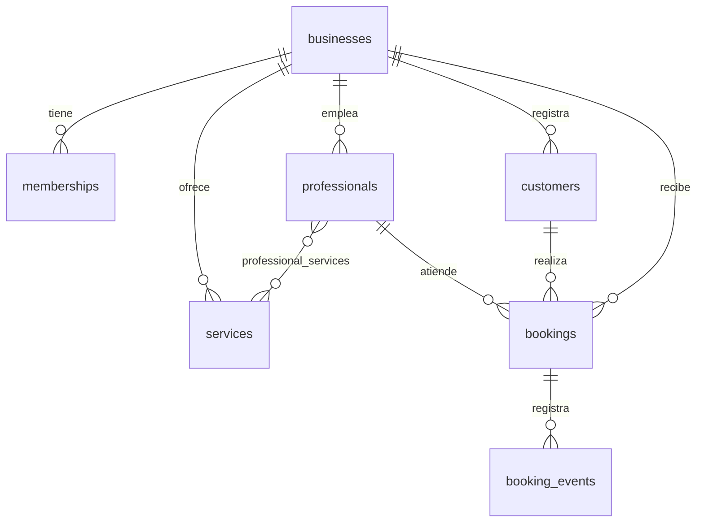

# Reserva2

Plataforma SaaS de gestión de citas y reservas para pequeños negocios y profesionales independientes.

Cada negocio tiene una página pública desde la que sus clientes reservan sin crear cuenta, y un panel privado para gestionar agenda, servicios, profesionales y clientes.

> **Estado:** Fase 1 — cimientos. La aplicación todavía no recibe reservas reales.

## Stack objetivo

| Capa | Tecnología |
|---|---|
| Frontend | React 19 · Vite 8 · TypeScript estricto |
| Estilos | Tailwind CSS v4 (`@theme`) · shadcn/ui re-tematizado |
| Routing y datos | React Router 7 · TanStack Query 5 · React Hook Form + Zod |
| Backend | Supabase (PostgreSQL · Auth · Storage) |
| Seguridad | Row Level Security · funciones RPC `SECURITY DEFINER` |
| Testing | Vitest · Testing Library · Playwright |
| Hosting | Vercel + Supabase Cloud |

> **Estado del scaffold:** solo está instalado el núcleo (React, Vite, TypeScript, Tailwind, React Router, TanStack Query, cliente de Supabase y Vitest). Las dependencias de las fases siguientes se incorporan en su rama, con aprobación previa.

## Estructura

```text
Reserva2/
├─ frontend/          # aplicación Vite + React
├─ supabase/          # migraciones, seed y configuración del proyecto
├─ docs/              # PRD · TRD · FLOW · UX · IMPLEMENTATION_PLAN · DECISIONS
├─ .github/workflows/ # CI
├─ .agents/skills/    # skills de diseño para agentes (con skills-lock.json)
└─ AGENTS.md, PROJECT_BRIEF.md, CONTEXT.md, MEMORY.md,
   SKILLS.md y checklists
```

## Requisitos

- Node.js 22+
- pnpm 11+
- Supabase CLI 3+ (`npx supabase`)
- Un proyecto Supabase (desarrollo)

No se requiere Docker: el proyecto de desarrollo es un proyecto Supabase en la nube y las migraciones se versionan en `supabase/migrations`.

## Configuración

1. Instala dependencias:

```bash
cd frontend
pnpm install
```

2. Copia las variables de entorno:

```bash
# raíz (CLI de Supabase)
copy .env.example .env

# frontend
copy frontend\.env.example frontend\.env.local
```

3. Completa los valores. `frontend/.env.local` solo contiene variables públicas (`VITE_*`); la `service_role` key nunca va ahí.

4. Enlaza el proyecto Supabase y aplica las migraciones:

```bash
npx supabase login
npx supabase link --project-ref <PROJECT_ID>
pnpm db:push
pnpm types:gen
```

## Desarrollo

```bash
pnpm dev          # servidor de desarrollo (frontend)
pnpm lint         # ESLint
pnpm typecheck    # TypeScript
pnpm test         # Vitest en modo watch
pnpm test:run     # Vitest una pasada
pnpm build        # build de producción
```

Disponible en `http://localhost:5173`.

## Base de datos

| Script | Qué hace |
|---|---|
| `pnpm db:push` | Aplica las migraciones pendientes |
| `pnpm db:diff` | Muestra el diff entre migraciones y base |
| `pnpm db:lint` | Analiza el esquema en busca de problemas |
| `pnpm db:reset` | Recrea la base local (requiere Docker) |
| `pnpm db:seed` | Carga los datos de demostración |
| `pnpm types:gen` | Regenera `frontend/src/types/database.generated.ts` |

Las migraciones son inmutables una vez aplicadas. Para corregir algo se añade una migración nueva.

## Modelo de datos



Detalle completo en [`docs/TRD.md`](docs/TRD.md).

## Documentación

| Documento | Contenido |
|---|---|
| [`AGENTS.md`](AGENTS.md) | Reglas de trabajo para agentes |
| [`PROJECT_BRIEF.md`](PROJECT_BRIEF.md) | Alcance, requisitos y preguntas abiertas |
| [`CONTEXT.md`](CONTEXT.md) | Arquitectura y decisiones estructurales |
| [`MEMORY.md`](MEMORY.md) | Decisiones cerradas y restricciones vigentes |
| [`SKILLS.md`](SKILLS.md) | Procedimientos repetibles |
| [`docs/PRD.md`](docs/PRD.md) | Product requirements |
| [`docs/TRD.md`](docs/TRD.md) | Contratos RPC, esquema y RLS |
| [`docs/FLOW.md`](docs/FLOW.md) | Flujos de usuario |
| [`docs/UX.md`](docs/UX.md) | Identidad visual y sistema de diseño |
| [`docs/IMPLEMENTATION_PLAN.md`](docs/IMPLEMENTATION_PLAN.md) | Fases, criterios de salida y rollback |
| [`docs/DECISIONS.md`](docs/DECISIONS.md) | ADRs |

## Skills para agentes

El proyecto incluye skills de diseño a nivel de repositorio, en `.agents/skills` (ubicación estándar de OpenCode a nivel proyecto), con `skills-lock.json` versionado en la raíz.

| Skill | Fuente | Instalaciones | Riesgo declarado por los escáneres |
|---|---|---|---|
| `frontend-design` | `anthropics/skills` | ~1,1 M | Revisar antes de aplicar |
| `web-design-guidelines` | `vercel-labs/agent-skills` | ~852 K | Revisar antes de aplicar |
| `ui-ux-pro-max` | `nextlevelbuilder/ui-ux-pro-max-skill` | ~447 K | Seguro · Bajo |
| `emil-design-eng` | `emilkowalski/skills` | ~440 K | Seguro · Bajo |
| `shadcn` | `shadcn/ui` | ~271 K | Seguro · Medio |

```bash
npx skills list         # skills instaladas en el proyecto
npx skills update -p    # actualizar a nivel proyecto
```

> Las skills se ejecutan con los permisos completos del agente. Revisa su contenido antes de aplicarlas.
>
> Se descartó `design-taste-frontend` (`leonxlnx/taste-skill`, 764 K descargas): la auditoría Gen Agent Trust Hub falla, Snyk avisa y su repositorio redistribuye ~38 MB de imágenes y assets de terceros que no conviene versionar ni usar sin revisión. Ver [`docs/DECISIONS.md`](docs/DECISIONS.md) (ADR-009).

## Fases

| Fase | Estado |
|---|---|
| 1 · Cimientos | En curso |
| 2 · Flujo público | Pendiente |
| 3 · Panel admin v1 | Pendiente |
| 4 · Reservas + calendario | Pendiente |
| 5 · Calidad | Pendiente |
| 6 · Publicación | Pendiente |

## Seguridad

- La `anon key` es pública por diseño; la protección real es Row Level Security.
- La `service_role` key nunca se usa en el navegador.
- Los datos de clientes no se registran en logs ni se incluyen en mensajes de error.
- Los solapamientos de reservas se impiden con una restricción `EXCLUDE` en PostgreSQL.

## Licencia

`Por definir`.
