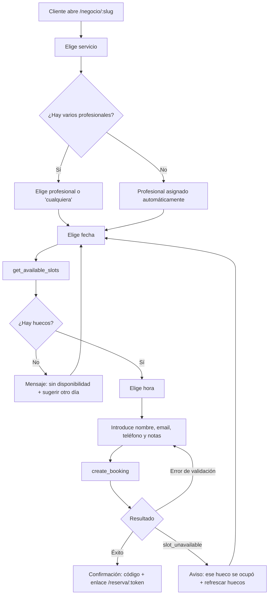
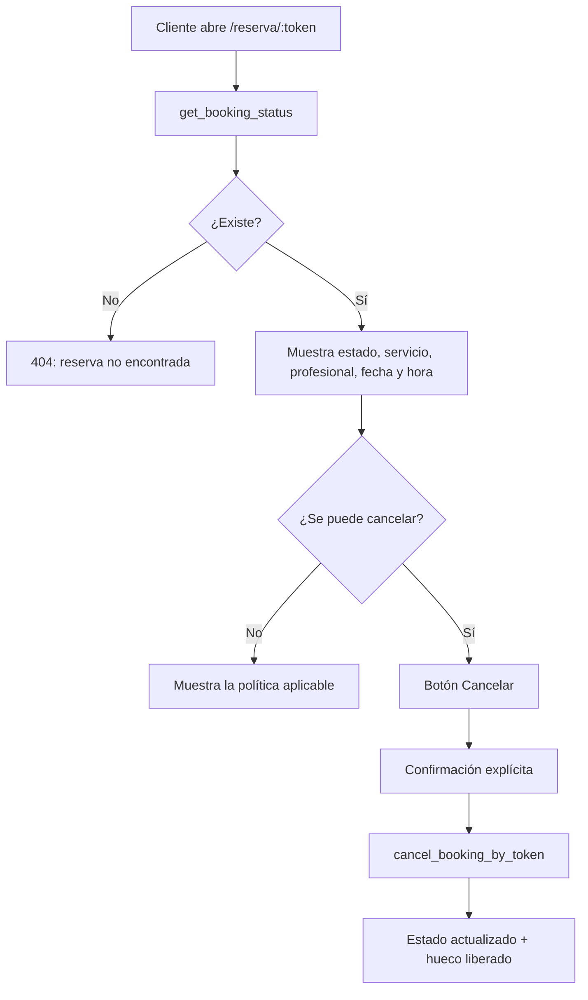
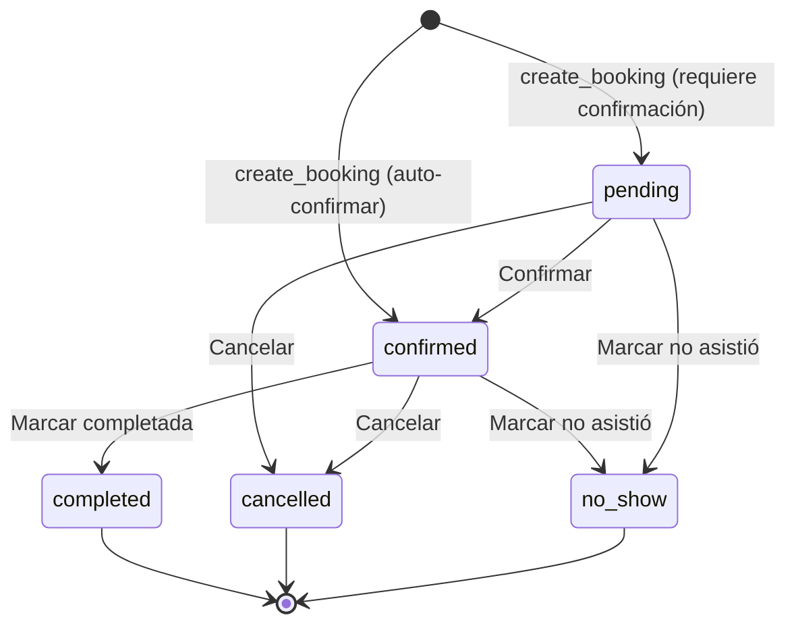
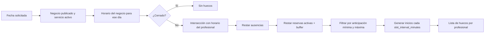

# FLOW — Flujos de usuario

> Diagramas en Mermaid. Se renderizan en GitHub y en Obsidian sin plugins extras.

## 1. Reserva pública (sin cuenta)



**Passos visibles para el usuario:** 5. Servicio → Profesional → Fecha y hora → Datos → Confirmación.

**Estado en la URL:** `?servicio=<id>&profesional=<id>&fecha=<yyyy-mm-dd>&hora=<iso>` para que atrás/adelante funcione y el enlace sea compartible.

## 2. Consulta y cancelación por token



## 3. Registro y onboarding del propietario

```mermaid
flowchart TD
    A[/crear-cuenta] --> B[Supabase Auth: email + contraseña]
    B --> C[Verificación de email]
    C --> D[/entrar]
    D --> E{¿Tiene negocio?}
    E -- No --> F[Formulario: nombre y slug del negocio]
    F --> G[create_business]
    G --> H[Horario por defecto lun-sáb 09:00-18:00]
    H --> I[Añadir primer servicio]
    I --> J[Añadir primer profesional y asignarle el servicio]
    J --> K[Revisar página pública]
    K --> L[Publicar negocio]
    L --> M[/panel]
    E -- Sí --> M
```

## 4. Gestión de una reserva en el panel



Cada transición escribe una fila en `booking_events` con estado origen, destino, actor y nota opcional.

## 5. Cálculo de disponibilidad



## 6. Navegación del panel

```mermaid
flowchart LR
    P[/panel] --> R[Reservas]
    P --> C[Calendario]
    P --> S[Servicios]
    P --> F[Profesionales]
    P --> K[Clientes]
    P --> G[Configuración]
    R --> D[Detalle de reserva]
    C --> D
    K --> H[Historial del cliente]
```
